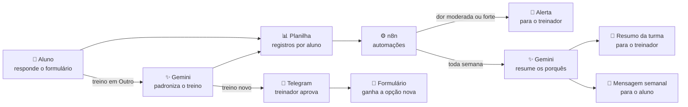

# 🏃‍♀️ Minha evolução na corrida

Uma ferramenta para assessorias de corrida que mostra ao treinador **como cada aluno iniciante sentiu cada treino e por quê**, a partir de um registro rápido que o aluno faz depois da aula.

## O problema

O treinador de uma turma de iniciantes acompanha cada aluno rumo à meta de **correr 5 km sem parar**, passando por 1 km e 3 km. Ele varia os treinos de propósito: alguns são leves, outros pesados, conforme o objetivo de cada momento.

Para decidir a evolução de cada aluno, ele precisa saber **como o aluno sentiu o treino e por quê**. Um treino pode ter parecido leve porque o aluno evoluiu, porque estava descansado ou porque o treino era leve mesmo. Hoje essa informação fica em conversas soltas no fim da aula, e se perde com uma turma inteira.

## A solução

Depois de cada aula, o aluno responde um formulário curto (menos de 1 minuto): qual foi o treino, se completou, o esforço, **o que influenciou o rendimento**, se teve dor e quanto correu sem parar.

- **O treinador** vê os registros organizados por aluno, recebe um **alerta na hora** quando alguém relata dor moderada ou forte, aprova pelo celular os **treinos novos** que os alunos descrevem e, toda semana, recebe um **resumo** com uma linha por aluno explicando como foi a semana e por quê.
- **O aluno** recebe uma mensagem semanal reconhecendo a constância e os **recordes**.

O sistema não avalia se o treino foi adequado: **quem interpreta e decide é o treinador**.

## Como funciona, com um exemplo

1. **Depois da aula, a Bia responde o formulário.** Escolhe o treino "Correr 6 min sem parar", conta que completou sem pausas, dá esforço 4 e marca que **já se acostumou com esse treino**.
2. **O Davi bate um recorde.** Ele correu 8 minutos sem parar; o máximo dele até então era 6. A planilha destaca o recorde no painel.
3. **O Léo fez um treino que não estava na lista.** Ele escolhe "Outro" e escreve "caminhei 1 e corri 5, umas 6 vezes". O Gemini padroniza como **"Correr 5 min + caminhar 1 min (6x)"** e confere que esse treino ainda não existe.
4. **O treinador recebe no Telegram** o treino sugerido, com os botões "Aprovar" e "Recusar". Ele aprova, e o treino aparece na lista do formulário para toda a turma. Se outros alunos descreverem o mesmo treino, eles são ligados a ele, sem duplicatas.
5. **A Carla relata dor forte no joelho.** O treinador recebe um alerta no Telegram na mesma hora.
6. **No domingo, o treinador recebe o resumo da semana:**
   > *Carla: relatou dor forte no joelho na quarta.*
   >
   > *Davi: novo recorde, de 6 para 8 minutos correndo sem parar.*
   >
   > *Bia: 3 aulas, completou todas. No treino de 6 min o esforço foi 4; ela marcou que já se acostumou com o treino.*
   >
   > *Léo: 2 aulas. No intervalado de 5 + 1 min, esforço 7; marcou que estava cansado.*
7. **O treinador decide** o que fazer com cada um. A Bia pode estar pronta para aumentar, ou o treino pode ter sido leve de propósito: ele é quem sabe.



## Como a IA é usada

- **Interpretar treinos:** quando o aluno descreve o treino com as próprias palavras, o Gemini transforma a frase num treino padronizado e verifica se ele já existe, com resposta em formato fixo (saída estruturada). Uma conferência por regra impede duplicatas, e treinos novos só aparecem para a turma depois que o treinador aprova.
- **Resumir os porquês:** no resumo semanal, o Gemini junta os registros de cada aluno numa frase que o treinador lê em segundos, sem julgar e sem sugerir o que fazer.
- **Escrever a mensagem semanal dos alunos**, reconhecendo a constância e os recordes.
- **Construir o projeto:** o Antigravity, agente de código, lê o `AGENTS.md` e as skills deste repositório para montar as automações e os testes seguindo as regras do projeto.

Os prompts seguem o método **GCCD** (objetivo, contexto, restrições e critério de pronto) e foram testados no Google AI Studio antes de entrar na automação. Os avisos dependem só de fatos (dor e recorde), calculados sem IA.

## Tecnologias

| Ferramenta | Papel no projeto |
|---|---|
| Google Forms | Registro pós-aula do aluno |
| Google Sheets | Guarda os registros e a lista de treinos, calcula os recordes e mostra o painel do treinador |
| Apps Script | Atualiza a lista de treinos do formulário quando o treinador aprova um treino novo |
| n8n | Liga as partes: interpretação e aprovação de treinos, alertas, mensagens e resumo semanal |
| Gemini | Interpreta treinos, resume a semana e escreve as mensagens |
| Telegram | Canal do treinador: alertas, aprovação de treinos e resumo |
| Google AI Studio | Teste dos prompts antes da automação |
| Antigravity | Agente de código usado para construir o projeto |

## Estrutura do repositório

```text
README.md                        Esta apresentação
AGENTS.md                        Regras do projeto para o agente de código
VERSAO-2.md                      Ideias para as próximas versões
skills/
  regras-dos-avisos/SKILL.md     As regras de dor e recorde, com casos de teste
  interpretar-treino/SKILL.md    Prompt, formato de resposta, aprovação e casos de teste dos treinos
  tom-das-mensagens/SKILL.md     Prompts, tom e cenários de teste das mensagens
apps-script/                     O script que atualiza a lista de treinos do formulário
n8n/                             As automações exportadas do n8n
testes/                          O resultado de cada rodada de testes
```

As **skills** são instruções que o agente de código carrega só quando a tarefa precisa delas. Cada skill traz junto os **casos de teste** que definem o comportamento esperado. A pasta **`testes/`** guarda o **resultado** de cada vez que esses casos foram rodados.

## Testes

O comportamento do projeto é verificado com dados fictícios:

- **7 casos** para os avisos: dor e recordes (incluindo empate e primeiro registro)
- **12 casos** para os treinos: ordem invertida, erros de digitação, frase vaga, tentativa de manipulação, treino implausível para iniciantes e três alunos descrevendo o mesmo treino ao mesmo tempo
- **8 cenários** para as mensagens, incluindo dor relatada, aluno sem registros e tentativa de manipular o resumo pelo campo de recado

## Andamento

O plano está dividido em etapas, cada uma com sua issue. Acompanhe no quadro do projeto, na aba **Projects** deste repositório.

## Privacidade

Nesta fase, a turma e todos os registros são fictícios. Como relatos de dor e bem-estar são dados sensíveis, o projeto já identifica os alunos por apelido e foi pensado para que um uso real tenha consentimento e guarde só o necessário.

## Próximos passos

As ideias para as próximas versões, como comparar o que o treinador planejou com o que o aluno sentiu e o piloto com uma turma real, estão em [`VERSAO-2.md`](VERSAO-2.md).

## Sobre

Projeto criado para praticar o que aprendi na **Imersão Dev: Engenharia de Software na Era da IA**, da Alura com o Google.
